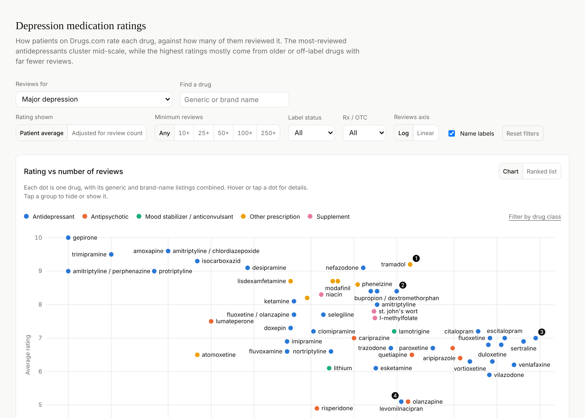

# Depression Medication Ratings

An interactive dashboard of how patients on Drugs.com rate medications used for depression and bipolar disorder, set against how many people reviewed each one.

**[Open the dashboard](https://ambilixer.github.io/med-ratings-dashboard/)**

[](https://ambilixer.github.io/med-ratings-dashboard/)

> **Not medical advice.** These are self-selected online reviews. They capture how people felt about a drug, not how well or how safely it works for any one person. Talk to a clinician before starting, stopping or switching a medication.

## What it shows

- **Rating vs number of reviews**: one dot per drug, colored by drug group, with a ranked-list alternative.
- **Ratings by drug class**: each drug plus its class's review-weighted average.
- **Major depression vs bipolar disorder**: drugs rated for both conditions, sorted by the gap between them.
- **All drugs**: a sortable table that includes drugs with no reviews yet.

There are three views: **Major depression** (the default), **Bipolar disorder**, and **Total** (both combined). You can also switch between raw patient averages and an **adjusted rating** that pulls drugs with only a few reviews toward the average. Filters cover review count, label status, Rx/OTC and drug class. Filter settings live in the page address, so you can share a link to a specific view.

## Data

- **Source:** the drug lists on Drugs.com's [Depression](https://www.drugs.com/condition/depression.html), Major Depressive Disorder and [Bipolar Disorder](https://www.drugs.com/condition/bipolar-disorder.html) condition pages, copied October 22 and 23, 2026.
- **Clean table:** [`data/drugscom_ratings_long.csv`](data/drugscom_ratings_long.csv), with one row per drug per condition plus combined rows for each view. Column definitions are in [`data/README.md`](data/README.md).
- **Method:** see [`notes/METHODOLOGY.md`](notes/METHODOLOGY.md) for how brand and generic listings are merged, how conditions are combined, how the adjusted rating works, and how drug classes were assigned.

This is an independent project, not affiliated with or endorsed by Drugs.com. The raw page text isn't included in this repo; [`data/raw/README.md`](data/raw/README.md) explains how to recreate it.

## Repo layout

```
data/
  drugscom_ratings_long.csv   clean table the dashboard uses
  drugscom_listings.csv       every listing as it appears on Drugs.com, before merging
  drug_meta.json              brand-to-generic map, drug classes and groups (generated)
  raw/                        your own copies of the Drugs.com page text (git-ignored)
scripts/
  make_meta.py                writes data/drug_meta.json
  parse_drugscom.py           raw page text -> the two CSVs
  build_dashboard.py          dashboard + data + d3 -> docs/index.html
dashboard/
  page.html                   the dashboard: markup, styles and chart code
  shell.html                  standalone wrapper: theme colors, footer, small data runtime
  vendor/                     d3 v7 (ISC license)
  fonts/                      Fira Sans, Latin subset (SIL Open Font License)
docs/
  index.html                  built, self-contained dashboard (served by GitHub Pages)
notes/
  METHODOLOGY.md              data decisions and caveats
```

## Rebuilding

You need Python 3.9+ with pandas.

```
pip install -r requirements.txt
python scripts/make_meta.py          # only needed after editing drug classes or brand names
python scripts/parse_drugscom.py     # only needed with fresh raw page text in data/raw/
python scripts/build_dashboard.py    # rebuilds docs/index.html from the CSV
```

On Windows, use `py` in place of `python` if `python` isn't recognized.

To change the dashboard itself, edit `dashboard/page.html`, run `build_dashboard.py`, and open `docs/index.html` in a browser to check it. Never edit `docs/index.html` directly, because the next build overwrites it.

## Contributing

Issues and pull requests are welcome, especially corrections to drug classes or brand-name mappings (in `scripts/make_meta.py`) and ideas for other review sources.

## License

The code is released under the [MIT License](LICENSE). d3 is included under its own [ISC license](dashboard/vendor/d3-LICENSE.txt), and the Fira Sans font under the [SIL Open Font License](dashboard/fonts/OFL.txt). The ratings and review counts come from Drugs.com and remain subject to Drugs.com's terms of use.
